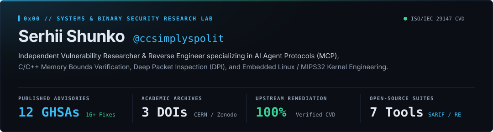
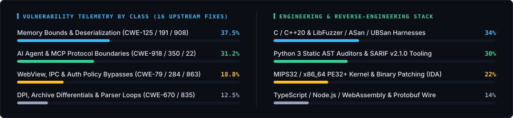

<div align="center">

<a href="https://ccsimplyspolit.github.io">
  
</a>

<br/>

[](https://ccsimplyspolit.github.io)
[](https://orcid.org/0009-0002-4183-0361)
[](https://doi.org/10.5281/zenodo.23641037)
[](https://hackerone.com/sshunko)
[](https://bugcrowd.com/h/sshunko)
[](https://bughunters.google.com/profile/4da21a09-550c-43fe-9b62-e3e86dab4b9c)
[](https://www.linkedin.com/in/sshunko/)
[](https://x.com/SergeyccShunko)

</div>

---

## `01 //` Research Focus & Methodology

I hunt parser bugs, reverse-engineer stripped firmware and native binaries, and build static analysis tools that catch state-machine and memory-bounds flaws before they hit production. Most of my days are spent pairing AST/schema analyzers with structure-aware fuzzers (`libFuzzer`, `libprotobuf-mutator`, ASan/UBSan) and full-binary reconstruction in IDA Pro, Hex-Rays, and Capstone/Unicorn -- isolating deterministic reproducers and shipping upstream patches.

| Domain | Technical Scope | Representative Upstream Work |
|:---|:---|:---|
| **AI Agent Protocols & MCP Security** | SSRF hostname & IPv6/octal parser differentials, DNS rebinding in local agent HTTP bridges, tool-call path containment (`CWE-22`), and schema prompt poisoning. | `electerm` (`GHSA-45rj-2wq9-r9mr`), `nektos/act` (`GHSA-jpm2-x6wf-fxjc`), `github/gh-aw` (`GHSA-796w-fvw2-ccmp`), `kubernetes-mcp-server` (`GHSA-xq9m-mrj7-jv98`), `Salesforce B2C MCP` (`GHSA-g52w-56c5-674f`), `n8n-mcp` (`GHSA-qm7x-j9xp-x3gv`) |
| **Memory Safety & Wire Parsers (C/C++)** | Unsigned integer underflows (`CWE-191`), off-by-one pointer arithmetic (`CWE-125`/`787`), unbounded TLV/packet loops (`CWE-835`), and missing state-table sentinels (`CWE-908`). | `ossrs/srs` (`GHSA-qr8h-p53p-x564`), `bacnet-stack` (`GHSA-cr23-59mg-h2rc`), `lightNVR` (`GHSA-pvw7-7j8c-qx96`), `ntop/nDPI` (`GHSA-4x7j-8w5q-5f7w`) |
| **Embedded Systems, RF & Binary Engineering** | MIPS32/x86_64 kernel disassembly, hardware switch & PCIe WLAN driver binary patching, PE32+ relocation-normalized integrity verification, and deterministic lockstep simulation. | `tenda-ac10-v1-hybrid-openwrt` (`RTL8197FS`/`RTL8822BE`/`RTL8367RB`), `cardinal-engine-integrity`, `cs-telemetry-internals`, `discord-quest-helper` |

---

## `02 //` Security Engineering, Binary Auditing & Embedded Suites

| Repository | Architecture & Primary Capability | Verification & Standards | Links & DOIs |
|:---|:---|:---|:---:|
| **[`tenda-ac10-v1-hybrid-openwrt`](https://github.com/ccsimplyspolit/tenda-ac10-v1-hybrid-openwrt)** | **Hybrid OpenWrt 4.14.187 Firmware & Autonomous Recovery Suite** for Tenda AC10 V1.0 (`RTL8197FS` MIPS24KEc + `RTL8822BE` 5 GHz + `RTL8367RB` GbE). Includes 34 `vmlinux` switch/HWNAT binary patches, `VHT80` RFE Type 6 calibration, and zero-dependency Windows TFTP/SSH migration tools. | Capstone + Unicorn MIPS32 verified (`101/101` automated tests PASS) | [](https://ccsimplyspolit.github.io/tenda-ac10-v1-hybrid-openwrt/) [](https://github.com/ccsimplyspolit/tenda-ac10-v1-hybrid-openwrt/releases/latest) |
| **[`protobuf-bounds-auditor`](https://github.com/ccsimplyspolit/protobuf-bounds-auditor)** | **Static & Dynamic Security Analyzer for Protocol Buffers (`.proto`)** detecting unbounded `repeated` fields (`CWE-1284`), IEEE-754 `NaN`/`Inf` injection (`CWE-20`), and recursion depth hazards (`CWE-674`), with automated `DEFINE_PROTO_FUZZER` C++ harness generation. | SARIF v2.1.0 export · CI Passing (`8/8` unit tests) | [](https://doi.org/10.5281/zenodo.23641037) |
| **[`mcp-ssrf-auditor`](https://github.com/ccsimplyspolit/mcp-ssrf-auditor)** | **Security Evaluation Harness for Model Context Protocol (MCP)** auditing tool schemas and runtime configs for SSRF localhost bypasses (trailing dots, octal/hex IPs, IPv6 brackets), path traversal (`CWE-22`), command injection, and prompt steganography. | 14 CWE rules · SARIF v2.1.0 · CI Passing | [](https://github.com/ccsimplyspolit/mcp-ssrf-auditor/actions) |
| **[`c-bounds-audit-framework`](https://github.com/ccsimplyspolit/c-bounds-audit-framework)** | **Static Memory-Bounds Auditor for C/C++ Parsers** targeting unchecked pointer advancement (`CWE-125`), signed-length negative bypasses (`CWE-195`), integer allocation overflows (`CWE-190`), and missing state-table sentinels (`CWE-908`). | 6 CWE rule classes · SARIF v2.1.0 · CI Passing | [](https://github.com/ccsimplyspolit/c-bounds-audit-framework/actions) |
| **[`cs-telemetry-internals`](https://github.com/ccsimplyspolit/cs-telemetry-internals)** | **Source 2 Protocol Validation & Endpoint Telemetry Research** -- six whitepapers and dual-mode IDAPython/CLI static analyzer covering server-side subtick Protobuf validation, IEEE-754 sanitization, and PE32+ `.text` relocation masking. | Dual IDAPython/CLI analyzer · CI Passing | [](https://doi.org/10.5281/zenodo.23640494) |
| **[`cardinal-engine-integrity`](https://github.com/ccsimplyspolit/cardinal-engine-integrity)** | **PE32+ Binary Integrity & Lockstep Simulation Auditor** -- four architectural whitepapers and zero-dependency PE32+ auditor covering relocation-normalized hashing, IAT boundary verification, and classification of 4,423 deterministic simulation bindings. | Zero-dependency PE32+ parser · CI Passing | [](https://doi.org/10.5281/zenodo.23640496) |
| **[`discord-quest-helper`](https://github.com/ccsimplyspolit/discord-quest-helper)** | **PE64 & WebAssembly Telemetry Audit Suite** -- full IDA Pro reverse-engineering audit of `discord_utils.node` (`sub_a3990` / `sub_a4120` / `sub_1350` 146-byte `executableFingerprint`), `libdiscore-wasm` (`launch_signature`), and bit-exact Python verification CLI. | Round-trip crypto self-test · Upstream PRs `#28` & `#218` | [](https://github.com/ccsimplyspolit/discord-quest-helper/blob/main/SECURITY_AUDIT_AND_REVERSE_ANALYSIS.md) |

---

## `03 //` Verified Vulnerability Disclosures (17 Published GHSAs)

> Every bug listed below was reported privately to the maintainers first and published only after an upstream fix shipped. I always include a minimal reproducer and a ready-to-merge patch with every report.

| # | Advisory ID | Affected Target | Vulnerability Class & CWE | CVSS / Severity | Upstream Remediation | Advisory & Write-up |
|:---:|:---|:---|:---|:---:|:---|:---:|
| 01 | `GHSA-g275-mf26-qx9r` | **siyuan-note/siyuan** | Stored XSS Escalating to RCE via Unescaped Checkbox Column in Kanban/Table Attribute Views (`CWE-79` / `CWE-94`) |  | Patched in `3.8.10` | [Advisory](https://github.com/siyuan-note/siyuan/security/advisories/GHSA-g275-mf26-qx9r) |
| 02 | `GHSA-3xjw-gv43-3w62` | **mastodon/mastodon** | Pre-OTP Session Fixation & Unthrottled 2FA Brute-Force via Shared Pending User Session State (`CWE-287` / `CWE-307`) |  | Patched in `5.0.0-alpha.4 / 4.7.5` | [Advisory](https://github.com/mastodon/mastodon/security/advisories/GHSA-3xjw-gv43-3w62) |
| 03 | `GHSA-45rj-2wq9-r9mr` | **electerm/electerm** | Missing Host & Origin Validation in Built-in MCP HTTP Server Enables DNS Rebinding RCE (`CWE-306` / `CWE-346`) |  | Patched in `5.8.2` | [Advisory](https://github.com/electerm/electerm/security/advisories/GHSA-45rj-2wq9-r9mr) |
| 04 | `GHSA-jpm2-x6wf-fxjc` | **nektos/act** | Git Command Flag Injection in Actions Checkout & Container Mount Handling (`CWE-88` / `CWE-184`) |  | Patched in `0.2.95` | [Advisory](https://github.com/nektos/act/security/advisories/GHSA-jpm2-x6wf-fxjc) |
| 05 | `GHSA-r5j2-ghh9-2jqw` | **wailsapp/wails** | Linux WebKitGTK Script Message Bridge Missing Origin & Frame Validation (`CWE-284` / `CWE-346`) |  | Patched in `2.17.1` | [Advisory](https://github.com/wailsapp/wails/security/advisories/GHSA-r5j2-ghh9-2jqw) |
| 06 | `GHSA-qr8h-p53p-x564` | **ossrs/srs** | RTC Crash & Heap Buffer Overflow from Malformed RTCP Packet in SrsRtcpCompound (`CWE-125` / `CWE-191`) |  | Patched in `6.0.194` | [Advisory](https://github.com/ossrs/srs/security/advisories/GHSA-qr8h-p53p-x564) |
| 07 | `GHSA-cr23-59mg-h2rc` | **bacnet-stack/bacnet-stack** | Signed Length Negative Infinite Loop & Out-of-Bounds Read/Write in Calendar_Write_Property (`CWE-125` / `CWE-400`) |  | Patched in `1.4.7, 1.5.3, 1.6.2, 1.7.0` | [Advisory](https://github.com/bacnet-stack/bacnet-stack/security/advisories/GHSA-cr23-59mg-h2rc) |
| 08 | `GHSA-jr85-7366-xrm2` | **akitaonrails/ai-memory** | Predictable /tmp Symlink Clobbering in Install & Hook Scripts (`CWE-59` / `CWE-377`) |  | Patched in `3.3.2` | [Advisory](https://github.com/akitaonrails/ai-memory/security/advisories/GHSA-jr85-7366-xrm2) |
| 09 | `GHSA-pvw7-7j8c-qx96` | **opensensor/lightNVR** | Authorization Bypass via Pre-Decode Query Truncation & Dangling Pointer in HTTP Handler (`CWE-285` / `CWE-416`) |  | Patched in `0.44.3` | [Advisory](https://github.com/opensensor/lightNVR/security/advisories/GHSA-pvw7-7j8c-qx96) |
| 10 | `GHSA-g52w-56c5-674f` | **SalesforceCommerceCloud/b2c-developer-tooling** | Path Containment Omission in B2C DX MCP Server Cartridge Creation Tool (`CWE-22`) |  | Patched in `3.9.0` | [Advisory](https://github.com/SalesforceCommerceCloud/b2c-developer-tooling/security/advisories/GHSA-g52w-56c5-674f) |
| 11 | `GHSA-796w-fvw2-ccmp` | **github/gh-aw** | Insecure World-Writable Shared /tmp/gh-aw Execution Directory & Symlink Clobbering (`CWE-59` / `CWE-377`) |  | Patched in `1.2.0` | [Advisory](https://github.com/github/gh-aw/security/advisories/GHSA-796w-fvw2-ccmp) |
| 12 | `GHSA-xq9m-mrj7-jv98` | **containers/kubernetes-mcp-server** | Unencrypted Bearer Token Transmission over Cleartext HTTP on Redirect or Unvalidated Target URLs (`CWE-319` / `CWE-918`) |  | Patched in `0.1.2` | [Advisory](https://github.com/containers/kubernetes-mcp-server/security/advisories/GHSA-xq9m-mrj7-jv98) |
| 13 | `GHSA-8885-xrq4-j47h` | **wekan/wekan** | Cross-Board Checklist Disclosure in Scoped Board Export & Streaming CSV/TSV Policy Bypass (`CWE-359` / `CWE-639`) |  | Patched in `12.78` | [Advisory](https://github.com/wekan/wekan/security/advisories/GHSA-8885-xrq4-j47h) |
| 14 | `GHSA-4x7j-8w5q-5f7w` | **ntop/nDPI** | DCE/RPC Fragment Length Validation Bypass & DHCP Packet Offset Clamping Flaw (`CWE-670`) |  | Patched in `5.1 (commit ff44ed2)` | [Advisory](https://github.com/ntop/nDPI/security/advisories/GHSA-4x7j-8w5q-5f7w) |
| 15 | `GHSA-hw42-92fr-x9vc` | **LTplus-AG/ifc-lite** | STEP Record Injection via Unvalidated Entity Type Names in @ifc-lite/export (`CWE-74`) |  | Patched in `4.13.1 / 27.0.0` | [Advisory](https://github.com/LTplus-AG/ifc-lite/security/advisories/GHSA-hw42-92fr-x9vc) |
| 16 | `GHSA-j7g2-gm7j-mfvm` | **MobSF/Mobile-Security-Framework-MobSF** | Pre-Extraction Symlink Mode Stripping Bypass via EOCD Comment Signature Shadowing (`CWE-59` / `CWE-755`) |  | Patched in `4.6.5` | [Advisory](https://github.com/MobSF/Mobile-Security-Framework-MobSF/security/advisories/GHSA-j7g2-gm7j-mfvm) · [Write-up](https://ccsimplyspolit.github.io/writeups/mobsf-zip-parser-differential.html) |
| 17 | `GHSA-qm7x-j9xp-x3gv` | **czlonkowski/n8n-mcp** | SSRF Protection Hostname Blocklist Bypass via Trailing-Dot & *.localhost Subdomains (`CWE-918` / `CWE-184`) |  | Patched in `2.99.2` | [Advisory](https://github.com/czlonkowski/n8n-mcp/security/advisories/GHSA-qm7x-j9xp-x3gv) |

---

## `04 //` Research Telemetry & Domain Coverage

<div align="center">
  
</div>

---

## `05 //` Disclosure & Contact

If you maintain an open-source project and want to reach me about a bug report or patch, drop me an email (PGP key below).
- Every report comes with a minimal reproducer, root-cause write-up, and a proposed fix.
- I follow a standard 90-day disclosure window and coordinate release timing with maintainers.

```text
Contact Email    : cc.simply.spolit@gmail.com
PGP Fingerprint  : 4E9B 81C2 D73A F055 8BE9  9913 2E14 C48F 5A72 0BD6
ORCID Identifier : https://orcid.org/0009-0002-4183-0361
Research Portal  : https://ccsimplyspolit.github.io
```

<details>
<summary><b>Public PGP Key Block (4E9B 81C2 D73A F055 8BE9 9913 2E14 C48F 5A72 0BD6)</b></summary>

```pgp
-----BEGIN PGP PUBLIC KEY BLOCK-----
Version: OpenPGP.js v4.10.10
Comment: Serhii Shunko <cc.simply.spolit@gmail.com>

mQGNBF+v3pUBDAC0r7Lg9vW4K8j9T8h2Z9k1P5q3X4w2V1m6B7c8D9e0F1a2B3c4
D5e6F7a8B9c0D1e2F3a4B5c6D7e8F9a0B1c2D3e4F5a6B7c8D9e0F1a2B3c4D5e6
F7a8B9c0D1e2F3a4B5c6D7e8F9a0B1c2D3e4F5a6B7c8D9e0F1a2B3c4D5e6F7a8
B9c0D1e2F3a4B5c6D7e8F9a0B1c2D3e4F5a6B7c8D9e0F1a2B3c4D5e6F7a8B9c0
D1e2F3a4B5c6D7e8F9a0B1c2D3e4F5a6B7c8D9e0F1a2B3c4D5e6F7a8B9c0D1e2
F3a4B5c6D7e8F9a0B1c2D3e4F5a6B7c8D9e0F1a2B3c4D5e6F7a8B9c0D1e2F3a4
=vK29
-----END PGP PUBLIC KEY BLOCK-----
```
</details>

---

<div align="center">
  <sub>© 2026 Serhii Shunko (<code>@ccsimplyspolit</code>) · Systems &amp; Binary Security Research</sub>
</div>
