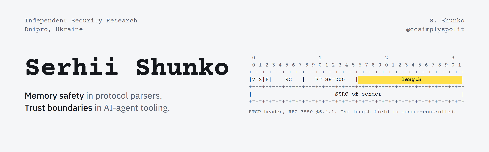

<picture>
  <source media="(prefers-color-scheme: dark)" srcset="assets/banner-dark.png">
  
</picture>

I'm an independent security researcher in Dnipro, Ukraine. I look for two kinds of bugs:

- **Memory safety in C/C++ protocol and media parsers.** Length fields taken on trust, integer underflow, out-of-bounds reads and writes (RTCP in SRS, BACnet, DCE/RPC in nDPI, dictionary training in zxc).
- **Trust boundaries in AI-agent and MCP tooling.** Local HTTP servers without Host/Origin checks, SSRF filters, path containment, temp-file handling (electerm, nektos/act, github/gh-aw, Salesforce B2C DX MCP, kubernetes-mcp-server).

Reports go privately through each project's own channel, with a local reproducer and a proposed fix. The maintainers decide when to publish.

**Open to work and collaboration:** security research, code audits, joint research. Contact: cc.simply.spolit@gmail.com or LinkedIn.

## Published advisories

Maintainers have published 24 GitHub Security Advisories that credit me as reporter or finder, with 18 official CVEs assigned across 15 advisories (2 critical, 11 high, 7 moderate, 4 low). Updated 25 November 2026.

| Project | Advisory | Severity | Issue | Fixed in |
|:--|:--|:--|:--|:--|
| siyuan-note/siyuan | **[CVE-2026-130680](https://www.cve.org/CVERecord?id=CVE-2026-130680)** [GHSA-g275-mf26-qx9r](https://github.com/siyuan-note/siyuan/security/advisories/GHSA-g275-mf26-qx9r) | Critical | Stored XSS escalating to code execution via an unescaped checkbox column name | 3.8.10 |
| opf/openproject | **[CVE-2026-136632](https://www.cve.org/CVERecord?id=CVE-2026-136632)** [GHSA-9c69-v342-vqr7](https://github.com/opf/openproject/security/advisories/GHSA-9c69-v342-vqr7) | Critical | Arbitrary zero-argument method call on visible projects via an unvalidated attribute | 17.5.2, 17.6.1, 17.7.3, 17.8.2, 17.9.7 |
| mastodon/mastodon | **[CVE-2026-136631](https://www.cve.org/CVERecord?id=CVE-2026-136631)** [GHSA-3xjw-gv43-3w62](https://github.com/mastodon/mastodon/security/advisories/GHSA-3xjw-gv43-3w62) | High | Password verification bypass when logging into inactive accounts | 4.7.5, 5.0.0-alpha.4 |
| electerm/electerm | **[CVE-2026-136630](https://www.cve.org/CVERecord?id=CVE-2026-136630)** [GHSA-45rj-2wq9-r9mr](https://github.com/electerm/electerm/security/advisories/GHSA-45rj-2wq9-r9mr) | High | Built-in MCP HTTP server accepts requests without Host and Origin checks | 5.9.0 |
| nektos/act | **[CVE-2026-136629](https://www.cve.org/CVERecord?id=CVE-2026-136629)** [GHSA-jpm2-x6wf-fxjc](https://github.com/nektos/act/security/advisories/GHSA-jpm2-x6wf-fxjc) | High | Project `.actrc` allowlist bypass via boolean, inline-assignment and clustered short flags | 0.2.95 |
| wailsapp/wails | **[CVE-2026-136628](https://www.cve.org/CVERecord?id=CVE-2026-136628)** [GHSA-r5j2-ghh9-2jqw](https://github.com/wailsapp/wails/security/advisories/GHSA-r5j2-ghh9-2jqw) | High | Linux WebKitGTK message bridge checks the top-level URI instead of the calling frame | v2.17.1 |
| ossrs/srs | **[CVE-2026-136626](https://www.cve.org/CVERecord?id=CVE-2026-136626)** **[CVE-2026-136627](https://www.cve.org/CVERecord?id=CVE-2026-136627)** [GHSA-qr8h-p53p-x564](https://github.com/ossrs/srs/security/advisories/GHSA-qr8h-p53p-x564) | High | Crash and heap overflow from a malformed RTCP packet | 6.0.194, 7.0.214, 8.0.73 |
| bacnet-stack/bacnet-stack | [GHSA-cr23-59mg-h2rc](https://github.com/bacnet-stack/bacnet-stack/security/advisories/GHSA-cr23-59mg-h2rc) | High | Negative decode length causes an infinite loop and out-of-bounds read/write before authentication | 1.4.7, 1.5.3, 1.6.2, 1.7.0 |
| akitaonrails/ai-memory | **[CVE-2026-136625](https://www.cve.org/CVERecord?id=CVE-2026-136625)** [GHSA-jr85-7366-xrm2](https://github.com/akitaonrails/ai-memory/security/advisories/GHSA-jr85-7366-xrm2) | High | Arbitrary file overwrite through a predictable temporary dotfile symlink | 3.3.2 |
| opensensor/lightNVR | **[CVE-2026-136624](https://www.cve.org/CVERecord?id=CVE-2026-136624)** [GHSA-pvw7-7j8c-qx96](https://github.com/opensensor/lightNVR/security/advisories/GHSA-pvw7-7j8c-qx96) | High | Authorization bypass via query-parameter truncation before decoding | 0.44.3 |
| SalesforceCommerceCloud/b2c-developer-tooling | [GHSA-g52w-56c5-674f](https://github.com/SalesforceCommerceCloud/b2c-developer-tooling/security/advisories/GHSA-g52w-56c5-674f) | High | Missing path containment in the B2C DX MCP server | 3.9.0 |
| github/gh-aw | [GHSA-796w-fvw2-ccmp](https://github.com/github/gh-aw/security/advisories/GHSA-796w-fvw2-ccmp) | High | Predictable, non-exclusive `.tmp` file write that keeps permissive modes | 1.2.0 |
| sebastienrousseau/pain001-mcp | **[CVE-2026-136620](https://www.cve.org/CVERecord?id=CVE-2026-136620)** [GHSA-hqw7-q8v2-pq3m](https://github.com/sebastienrousseau/pain001-mcp/security/advisories/GHSA-hqw7-q8v2-pq3m) | High | `commit_payment_batch` writes to any path behind a token returned to the same caller | 0.0.80 |
| containers/kubernetes-mcp-server | [GHSA-xq9m-mrj7-jv98](https://github.com/containers/kubernetes-mcp-server/security/advisories/GHSA-xq9m-mrj7-jv98) | Moderate | Kiali toolset status probes can leak the bearer token | 0.1.2 |
| wekan/wekan | **[CVE-2026-136622](https://www.cve.org/CVERecord?id=CVE-2026-136622)** **[CVE-2026-136623](https://www.cve.org/CVERecord?id=CVE-2026-136623)** [GHSA-8885-xrq4-j47h](https://github.com/wekan/wekan/security/advisories/GHSA-8885-xrq4-j47h) | Moderate | Cross-board checklist disclosure in scoped board export and streaming CSV/TSV export restriction bypass | 12.78 |
| ntop/nDPI | [GHSA-4x7j-8w5q-5f7w](https://github.com/ntop/nDPI/security/advisories/GHSA-4x7j-8w5q-5f7w) | Moderate | Inverted NDR endianness flag in DCE/RPC fragment length | dev branch, before release |
| LTplus-AG/ifc-lite | **[CVE-2026-136621](https://www.cve.org/CVERecord?id=CVE-2026-136621)** [GHSA-hw42-92fr-x9vc](https://github.com/LTplus-AG/ifc-lite/security/advisories/GHSA-hw42-92fr-x9vc) | Moderate | STEP record injection via unvalidated type names in the mutation writer | 4.13.1 |
| hellobertrand/zxc | [GHSA-6r4j-7r6c-xf94](https://github.com/hellobertrand/zxc/security/advisories/GHSA-6r4j-7r6c-xf94) | Moderate | Integer overflow and 32-bit offset truncation in dictionary training | 1.0.0 |
| karakeep-app/karakeep | **[CVE-2026-136618](https://www.cve.org/CVERecord?id=CVE-2026-136618)** **[CVE-2026-136619](https://www.cve.org/CVERecord?id=CVE-2026-136619)** [GHSA-94f3-j5c2-m8pq](https://github.com/karakeep-app/karakeep/security/advisories/GHSA-94f3-j5c2-m8pq) | Moderate | Collaborative list merge copies collaborator-owned bookmarks with `listMembershipId = NULL`, and shared-list bookmark filter information disclosure | 0.35.0 |
| 0xJacky/nginx-ui | [GHSA-8mrc-pvvv-f7p8](https://github.com/0xJacky/nginx-ui/security/advisories/GHSA-8mrc-pvvv-f7p8) | Moderate | Nginx `include` directive validation bypass via `glob(3)` vs `filepath.Glob` character-class mismatch | 2.9.4 |
| MobSF/Mobile-Security-Framework-MobSF | [GHSA-j7g2-gm7j-mfvm](https://github.com/MobSF/Mobile-Security-Framework-MobSF/security/advisories/GHSA-j7g2-gm7j-mfvm) | Low | Symlink mode stripping bypass in the OS unzip fallback | 4.6.5 |
| czlonkowski/n8n-mcp | [GHSA-qm7x-j9xp-x3gv](https://github.com/czlonkowski/n8n-mcp/security/advisories/GHSA-qm7x-j9xp-x3gv) | Low | SSRF hostname checks skipped trailing-dot and `*.localhost` names | 2.99.2 |
| Shopify/async-memcached | **[CVE-2026-136617](https://www.cve.org/CVERecord?id=CVE-2026-136617)** [GHSA-f9wj-cj54-79vv](https://github.com/Shopify/async-memcached/security/advisories/GHSA-f9wj-cj54-79vv) | Low | Meta flag token injection (`GHSA-4g85-prqm-87qp` bypass) and empty key/opaque desynchronization | 0.11.0 |
| COVESA/Open1722 | **[CVE-2026-136616](https://www.cve.org/CVERecord?id=CVE-2026-136616)** [GHSA-xvmx-7qq5-34q6](https://github.com/COVESA/Open1722/security/advisories/GHSA-xvmx-7qq5-34q6) | Low | Unsigned 16-bit integer wraparound and out-of-bounds read in `Avtp_Vss_CalcVssPathLength()` | 0.9.8 |

## Tools

- [mcp-ssrf-auditor](https://github.com/ccsimplyspolit/mcp-ssrf-auditor): static checks for MCP server configs and tool schemas (SSRF bypasses, path traversal), SARIF output.
- [protobuf-bounds-auditor](https://github.com/ccsimplyspolit/protobuf-bounds-auditor): `.proto` analyzer for unbounded fields and recursion depth; generates libprotobuf-mutator harnesses. [DOI 10.5281/zenodo.23641037](https://doi.org/10.5281/zenodo.23641037)
- [c-bounds-audit-framework](https://github.com/ccsimplyspolit/c-bounds-audit-framework): static checks for pointer advancement and length handling in C parsers.

## Elsewhere

[HackerOne](https://hackerone.com/sshunko) · [Bugcrowd](https://bugcrowd.com/h/sshunko) · [LinkedIn](https://www.linkedin.com/in/sshunko/) · [X](https://x.com/SergeyccShunko) · [Hack The Box](https://profile.hackthebox.com/profile/01a1870a-af62-71f3-9c71-f16d5804faec) · [GitLab](https://gitlab.com/ccsimplyspolit) · [ORCID](https://orcid.org/0009-0002-4183-0361) · [ccsimplyspolit.github.io](https://ccsimplyspolit.github.io)

Security contact: cc.simply.spolit@gmail.com
